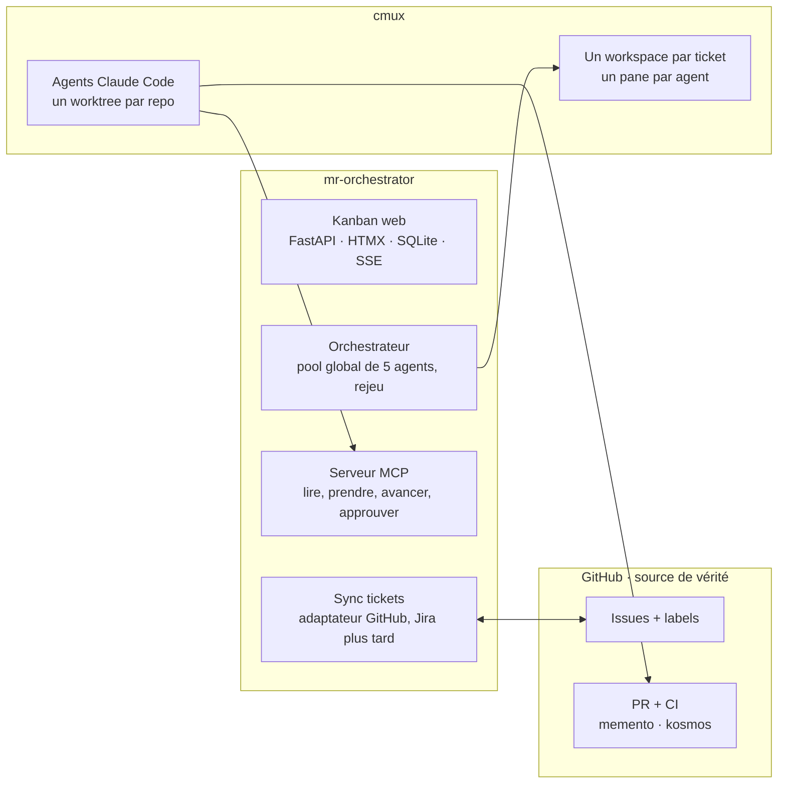

# MrOrchestrator — brief du workflow d'agents IA

Version du 24 novembre 2026. Source : le doc « MrOrchestrator — brief du workflow d'agents IA ».

## Noms

L'orchestrateur porte un nom générique parce qu'il servira sur d'autres projets ; le projet test garde un thème stoïcien : Memento cherche, Kosmos montre.

| Nom | Rôle | Pourquoi ce nom |
| --- | --- | --- |
| `mr-orchestrator` | Orchestrateur, Kanban, sync, serveur MCP, CLI `mro` | Générique et réutilisable : rien ne le lie au projet test |
| `memento` | Moteur RAG : ingestion, embeddings, recherche, éval, MCP `cite_me` | « Souviens-toi » : il retrouve les pensées, et *memento mori* traverse les *Pensées* |
| `kosmos` | Front de visualisation : carte des pensées, dashboard d'éval | Le cosmos stoïcien est un tout ordonné : chaque pensée y a sa place sur la carte |

Les agents gardent des noms de rôle (PO, architecte, dev, QA, arbitre, rétro) : un nom fonctionnel se lit mieux dans cmux et dans les labels. Les runs sont numérotés `run-001`, `run-002`…

## Vision et objectifs

Le test réussit si je pilote des agents comme une équipe : je vois où en est chaque ticket, je ne valide que ce qui compte, et je peux rejouer le même scénario pour comparer.

- **Voir les tâches** : le Kanban `mr-orchestrator` montre chaque ticket, son étape, l'agent qui le porte et son coût.
- **Voir les agents** : cmux montre un workspace par ticket, un pane par agent, et signale ce qui attend une validation.
- **Posture PO et CTO senior** : les tickets atteignent une Definition of Ready avant tout code ; l'humain intervient aux quatre validations, pas au fil de l'eau.
- **Rejouer** : le même backlog de faux tickets se rejoue depuis un état connu, pour comparer des runs, faire une démo ou ajuster les validations.
- **Hors périmètre pour l'instant** : un autre agent que Claude Code, Jira (prévu par l'adaptateur, pas branché).

## Architecture

GitHub reste la source de vérité ; `mr-orchestrator` en est la vue enrichie et le chef d'orchestre ; cmux est la fenêtre sur les agents.

La sync tient le board à jour dans les deux sens. L'orchestrateur ouvre les workspaces via la CLI cmux. Les agents parlent à `mr-orchestrator` par MCP et poussent leurs PR sur GitHub.

## Cycle de vie d'un ticket et labels

Une colonne du Kanban = un label `status:*` dans GitHub ; un agent « s'assigne » un ticket en posant son label `agent:*`.

| Colonne | Label | Qui fait avancer | Si rejet |
| --- | --- | --- | --- |
| Brouillon | `status:draft` | Agent PO (séance de questions) | — |
| DoR à valider | `status:dor-review` | Toi, validation 1 | Retour en Brouillon |
| Ready | `status:ready` | Orchestrateur, dès qu'un slot se libère | — |
| Plan | `status:planning` | Agent architecte | — |
| Plan à valider | `status:plan-review` | Toi, validation 2 | Retour en Plan |
| En dev | `status:dev` | Agent dev | — |
| En QA | `status:qa` | Agent QA | Retour en dev |
| Arbitrage | `status:arbitrage` | Agent arbitre : pose `merge:auto` ou `merge:human` | — |
| Revue PR | `status:pr-review` | Toi, validation 3 (si `merge:human`) | Retour en dev |
| Fait | `status:done` | Merge | — |
| Bloqué | `status:blocked` | N'importe quel agent, après 3 échecs | Toi décides |

Autres familles de labels :

- `agent:po`, `agent:archi`, `agent:dev`, `agent:qa`, `agent:arbitre`, `agent:retro` : qui tient le ticket maintenant.
- `repo:memento`, `repo:kosmos`, `repo:mr-orchestrator` : un ticket multi-projet porte plusieurs labels `repo:*`.
- `risk:low`, `risk:med`, `risk:high` : posé par l'agent PO, relu à la validation 1.
- `merge:auto`, `merge:human` : posé par l'arbitre.
- `model:opus`, `model:sonnet`, `model:haiku` : force le modèle d'un ticket.
- `run:001`… : le run auquel appartient le ticket (créé par `mro run new`).

## Agents et parallélisme

Six agents Claude Code, un rôle chacun, partagent un pool global de 5 slots, tous tickets et tous repos confondus.

| Agent | Modèle par défaut | Entrée | Sortie | Appuis |
| --- | --- | --- | --- | --- |
| PO | Opus | Un besoin écrit par toi | Un ticket au gabarit DoR, `risk:*` posé | Skill de type `grill-with-docs`, lecture du code |
| Architecte | Opus | Ticket Ready | Plan + schéma Mermaid en commentaire | Lecture des 3 repos |
| Dev | Sonnet | Plan validé | Branche, tests, PR (une par repo touché) | Un worktree git par repo |
| QA | Sonnet | PR ouverte | Verdict sur chaque critère d'acceptation, score d'éval | Jeu d'éval de `memento` |
| Arbitre | Haiku | Verdict QA + diff | `merge:auto` ou `merge:human` + justification en commentaire | Grille calculée par script, l'agent la lit et rédige |
| Rétro | Sonnet | Fin du run | Synthèse : livré, bloqué, coût, allers-retours | Métriques du run |

Le modèle se règle par rôle dans `config/agents.yaml` et passe à Claude Code par `--model`, avec un alias (`opus`, `sonnet`, `haiku`) qui survit aux changements de version. Trois niveaux, du plus général au plus précis : le rôle, la variante de run, puis le ticket avec un label `model:*`.

Règles du pool :

- Un slot = un agent qui tourne. Le 6e attend, en file dans `mr-orchestrator`.
- Un ticket peut occuper plusieurs slots à la fois : par exemple deux agents dev, un sur `memento` et un sur `kosmos`.
- Un agent qui attend une validation libère son slot.
- Dans cmux : un workspace par ticket, un pane par agent actif ; l'orchestrateur les ouvre et les ferme via la CLI cmux.

## Validations humaines

Quatre validations, trois façons de répondre, une seule action `approve` ou `reject` enregistrée dans `mr-orchestrator`.

| Validation | Tu vérifies | Label avant | Si oui | Si non |
| --- | --- | --- | --- | --- |
| 1. DoR | Le ticket est clair, testable, découpé, risque juste | `status:dor-review` | `status:ready` | `status:draft` + ta raison |
| 2. Plan | Le plan et le schéma tiennent la route | `status:plan-review` | `status:dev` | `status:planning` + ta raison |
| 3. PR | Le code, quand l'arbitre demande un humain | `status:pr-review` | Merge | `status:dev` + ta raison |
| 4. Rétro | La synthèse du run | Fin de run | Run clôturé | Notes pour le run suivant |

Les trois canaux mènent au même événement :

- **Kanban** : boutons Approuver / Rejeter sur la carte.
- **GitHub** : commentaire `/approve` ou `/reject <raison>`, capté par la sync.
- **cmux** : la notification du workspace propose `mro approve 12` ou `mro reject 12 "raison"`.

Le journal des validations sert aux métriques : combien d'allers-retours par validation, combien de temps un ticket t'attend.

Gabarit DoR : pour commencer, tous les champs sont obligatoires (voir `.github/ISSUE_TEMPLATE/ticket-dor.md`). La validation 1 n'est proposée que si chacun est rempli.

- **Contexte** : le besoin et pourquoi maintenant.
- **Critères d'acceptation** : vérifiables par l'agent QA.
- **Hors périmètre** : ce que le ticket ne fait pas.
- **Dépendances** : tickets à livrer avant.
- **Risque** : `risk:low`, `risk:med` ou `risk:high`, avec une phrase de justification.
- **Repos** : les labels `repo:*` touchés.

## Grille de l'agent arbitre

L'auto-merge n'est permis que si tous les critères sont au vert ; un seul critère rouge envoie la PR en revue humaine. Les seuils sont une première proposition, à calibrer grâce aux rejeux.

| Critère | Auto-merge possible si | Revue humaine si |
| --- | --- | --- |
| CI | Verte | Rouge : bloquant, jamais de merge |
| Taille du diff | ≤ 150 lignes hors tests | > 150 lignes |
| Zones sensibles | Aucune touchée | Ingestion, embeddings, index, CI, config des agents |
| Dépendances | Aucune ajoutée | Nouvelle dépendance ou montée de version majeure |
| Score d'éval (rappel@5) | Stable ou en hausse | En baisse |
| Tests | Code ajouté = tests ajoutés | Code sans test |
| Périmètre | Un seul repo | Plusieurs repos |
| Risque du ticket | `risk:low` | `risk:med` ou `risk:high` |

L'arbitre publie en commentaire de PR le tableau rempli et sa décision. La rétro compare ses décisions aux tiennes : une PR qu'il aurait auto-mergée et que tu aurais rejetée est un signal pour resserrer la grille.

## Rejeu et métriques

Un run ne touche jamais `main` : il part d'un tag de référence et merge dans sa propre branche `run/NNN`, donc on le rejoue ou on le jette sans force-push.

1. Chaque repo du projet test porte un tag `baseline-v0`, l'état de départ connu.
2. Les faux tickets vivent en YAML dans `backlogs/` (par exemple `demo-17.yaml`).
3. `mro run new --backlog demo-17 --variant <nom>` crée la branche `run/NNN` dans chaque repo depuis le tag, ouvre les issues avec `run:NNN` et vide l'état du board.
4. Les PR du run ciblent `run/NNN`, pas `main`.
5. `mro run close NNN` lance la rétro, ferme les issues et archive les métriques.
6. `mro run purge NNN` supprime les branches et les issues du run.

La `--variant` dit ce qu'on compare : le modèle d'un rôle, un prompt d'agent, un `CLAUDE.md`, la grille de l'arbitre, ou les validations actives.

Métriques de chaque run :

- durée par ticket et par étape, temps passé à t'attendre ;
- tokens et coût par ticket, par agent et par modèle ;
- allers-retours par validation, tickets bloqués ;
- part d'auto-merge, et désaccords entre l'arbitre et toi ;
- rappel@5 et MRR de `memento` en fin de run.

## Corpus et éval

Le corpus est la traduction de Jules Barthélemy-Saint-Hilaire (Germer-Baillière, 1876) : elle est dans le domaine public, donc commitable dans des repos publics.

- **Source** : [Wikisource](https://fr.wikisource.org/wiki/Pens%C3%A9es_pour_moi-m%C3%AAme/Livre_VI) publie le texte livre par livre, pensées numérotées en chiffres romains.
- **Piège utile** : l'édition contient les commentaires du traducteur entre les pensées ([exemple](https://fr.wikisource.org/wiki/Page%3APens%C3%A9es_de_Marc-Aur%C3%A8le%2C_trad._Barth%C3%A9lemy-Saint-Hilaire.djvu/71)). Les séparer est un vrai ticket, avec un vrai risque de pollution de l'index.
- **Unité de recherche** : une pensée = un document, identifié `livre.pensée` (par exemple `VI.1`).
- **Stack locale, sans modèle payant** : embeddings multilingues (bge-m3 ou multilingual-e5) via sentence-transformers, index local (LanceDB ou sqlite-vec), BM25 pour l'hybride, Ollama en option pour la génération.
- **Éval** : un jeu d'environ 40 questions, chacune avec les pensées attendues, versionné dans `memento/eval/`. Mesures : rappel@5 et MRR.

## Backlog de faux tickets

Voir `backlogs/demo-17.yaml` (17 besoins bruts, dont 3 pièges) et `backlogs/run-000.yaml` (le mini-run de rodage).

## Décisions et questions ouvertes

Décidé :

- Les 3 repos vont sur le compte GitHub perso.
- Gabarit DoR : tous les champs obligatoires pour commencer.
- Un modèle par rôle, surchargeable par run et par ticket.

Questions ouvertes :

- Quelle source libre pour Épictète, si l'on veut garder la comparaison ?
- Le quota Claude Code tient-il 5 agents en parallèle sur un run complet ? À mesurer au premier run.
- Les seuils de la grille de l'arbitre : à valider ou ajuster avant le premier run.
- La répartition des modèles par défaut : à confirmer par un run comparatif.

## Ordre de construction du MVP

1. `mro labels sync` : crée les labels dans les 3 repos (le kit de démarrage l'a déjà fait une fois).
2. Sync GitHub vers SQLite, puis un Kanban en lecture seule.
3. `mro start <issue> --role dev` : ouvre un workspace cmux et lance Claude avec le bon modèle.
4. Serveur MCP (prendre, avancer, approuver) et les 3 canaux de validation.
5. Pool de 5 agents, puis `mro run new|close|purge`.
6. Arbitre et rétro.

Premier test : `run-000` avec les tickets 1, 6 et 15 de `demo-17`.
